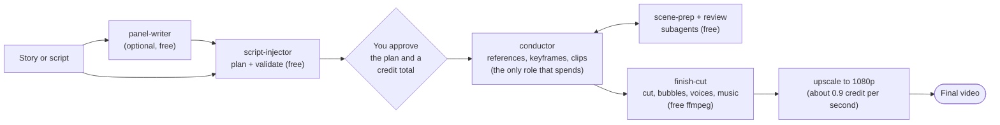
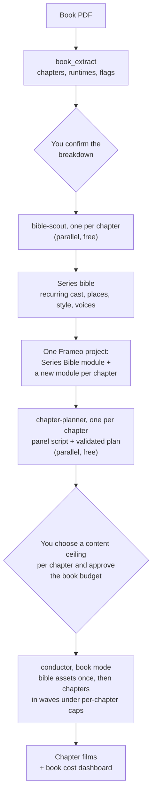

# frameorelay

A set of [Agent Skills](https://agentskills.io/) that turns a script, **or a whole book**, into finished videos through the [Frameo](https://frameo.ai/mcp) MCP, with a validated contract that keeps many scenes **continuous, on-style and inside an approved budget**. It runs in **Claude Code and Claude Cowork, OpenAI Codex, and other agents that read `SKILL.md` skills** (Gemini CLI, Cursor, ...); see [Works with](#works-with).

> Unofficial. Not made by or affiliated with Frameo or Anthropic. It drives the Frameo MCP, which **spends real credits** on your Frameo account: read "Cost and safety" before running a job.

Status: v0.8.0, early. It was built on real runs (short films, then a ten-chapter book) and the lessons from them are in the skills. Expect rough edges; issues and PRs are welcome.

> **Licence: free for individuals, paid for organisations.** Solopreneurs and freelancers working alone, and anyone using it noncommercially, use it free. A company, agency, studio or team using it commercially needs a perpetual commercial licence: see [COMMERCIAL-LICENSE.md](COMMERCIAL-LICENSE.md).

> **New in 0.7: render order that keeps continuity and still fans out.** A chain is now a continuity group (one place, unbroken time): its shots render one after another, each opening on the real last frame of the one before and passing a quick face-and-clothing check before the next starts, while genuinely separate scenes render in parallel, one scene agent each (up to 4 at a time). `check-chains` now warns when adjacent chains share a place with no stated break. The first book rendered every shot in parallel and paid for it in continuity repairs; this is the fix.

> **Proven on a whole book.** v0.6 comes from producing a full novel end to end: **10 chapters, about 99 minutes of vertical 9:16 film**, each chapter in its own Frameo module with its own credit cap, voiced, scored, lip-synced wherever a speaker is clearly visible, with comic speech bubbles, captions and halftone transitions on every cut. **439,280 credits in total, about 4,400 per finished minute, all-in**, including two complete fix sweeps and re-shoots. The sweeps are where it earned its keep: they caught wrong-face lipsync (the lipsync model moves one face, and not always the speaker's), clothes that came off, went back on and came off again, and continuity drift, and the fixes are now written into the skills so the next book skips those mistakes.

> **New in 0.6:** a [production playbook](skills/book-breakdown/references/production-playbook.md) learned on that book (scene-master continuity repair, per-speaker lipsync, clothing-continuity rules, running chapters in parallel), a **series style charter gate** (a chapter is not finished without bubbles on every dialogue line, caption boxes and the transition rules), [content-ceiling tiers](skills/conductor/references/content-boundaries.md), and `overlay_pass.py`, which adds speech bubbles, captions, halftone wipes in all eight directions and zoom-and-fade scene changes to a finished cut without touching its length or audio.

> **Whole books (0.5):** give it a book PDF and `book-breakdown` finds the chapters, sets each chapter's film length from its size (3 to 15 minutes), builds one shared series bible (recurring characters, places and style), gives **every chapter its own new Frameo module** in one project, plans all chapters **in parallel**, and ends in one book plan with a credit cap per chapter. [Read the whole-book pipeline](#whole-books-the-book-breakdown-pipeline) or say *"use the book breakdown on this PDF"*.

**Jump to:** [Credit economics](#credit-economics-what-this-saves) · [Pipeline (one script)](#the-pipeline) · [**Whole books**](#whole-books-the-book-breakdown-pipeline) · [Get started](#get-started) · [What to expect](#what-to-expect) · [What you change, and when](#what-you-change-and-when) · [Install](#install) · [Works with Codex, Gemini CLI, Cursor](#works-with)

## Credit economics: what this saves

A finished 4:30 script-to-video film used to cost **65,000 to 80,000 credits** without this package. Three productions made with it cost **about 10,000 to 25,000 credits per 4:30 of film (about 17,000 on average)**:

> ### ≈ 77% fewer credits on average, about 55,000 credits saved per 4:30 film
> Range across the three productions: **66% to 86% saved** (≈ 47,800 to 62,500 credits).

| Production | Finished film | Credits spent | Per 4:30 of film | Saved vs 65,000 | Saved vs 80,000 | Credits saved (vs 72,500 midpoint) |
|---|---|---|---|---|---|---|
| Run 1: 19-clip romance short (480p drafts, 720p, 1080p; style changed mid-run) | 4:38, 1080p | 25,399 | ≈ 24,700 | **62%** | **69%** | **≈ 47,800 (66%)** |
| Run 2: 12-shot vertical film | 4:00, 1080p | ≈ 8,700 to 11,000 | ≈ 10,000 to 12,700 | **80% to 85%** | **84% to 88%** | **≈ 59,800 to 62,500 (83% to 86%)** |
| Run 3: 17-shot hard-cut film, two user-requested retake rounds | 5:04, 1080p | ≈ 16,500 | ≈ 14,900 | **77%** | **81%** | **≈ 57,500 (79%)** |
| **Average** | | | **≈ 17,000** | **≈ 74%** | **≈ 79%** | **≈ 55,500 (≈ 77%)** |
| **Without the package** | 4:30 | 65,000 to 80,000 | 65,000 to 80,000 | | | |

Per finished minute that is about 14,400 to 17,800 credits before, and 2,200 to 5,500 with the package. **A 4:30 film now budgets at roughly 8,600 to 14,700 credits** (from no retakes to heavy retake rounds); see the [budget table](docs/credit-economics.md#budgeting-a-job).

Where the savings come from: finishing by **upscale** (about 243 credits for 270 s, against 19,440 for a native 1080p render), going **straight to 720p** instead of a separate 480p draft pass (which was 31% of Run 1's spend), **one approved total with quotes before every spend**, **fixing in the free edit** instead of regenerating, and **fixing references and keyframes first** (2 to 18 credits each, against 280 to 840 for the clip that depends on them). Method, per-item breakdown and caveats: [docs/credit-economics.md](docs/credit-economics.md). Planning a whole book? Budget it chapter by chapter: [book-scale costs](#whole-books-the-book-breakdown-pipeline) and [the book budgeting formula](docs/credit-economics.md#budgeting-a-whole-book).

The 65,000 to 80,000 baseline is the maintainer's figure from earlier productions made without the package (no ledgers from those runs are kept here), and three runs is a small sample: read it as "against the baseline we experienced", not a controlled experiment.

## The pipeline

*Starting from a whole book rather than one script? Jump to [Whole books](#whole-books-the-book-breakdown-pipeline).*



| # | Stage | Skill | What happens | Credits | You do |
|---|---|---|---|---|---|
| 1 | Story to shot tables | `panel-writer` (optional) | Turns a plain story into a panel script: style bible, one table per shot, checklist. Your words stay exact; invented lines are marked. | 0 | Read the shot tables, fix the story |
| 2 | Plan | `script-injector` | Splits the script into chains and segments, builds cast, style anchor, sealed prompts, dialogue (invented lines flagged), validates it. | 0 | Answer a few questions; read the plan |
| 3 | Approval | (you) | Plan shown with a cost estimate. Nothing is generated until you say yes and a total is quoted. | 0 | **Approve the plan and the credit total** |
| 4 | References and keyframes | `conductor` | Character sheets, location plates, first and last frame stills for every shot. | 2 to 18 per image | Approve faces, look, outfits |
| 5 | Clips | `conductor` + `scene-prep` and `review` subagents | Up to 10 clips per call render in parallel; every clip is reviewed on its real frames; one retake per bad shot. | 28 per second at 720p (about 840 per 30 s) | Wait; approve retakes |
| 6 | Speech, music, effects | `conductor` | Voiced dialogue and narration, story-themed music, sound effects. | about 1 to 2 per line; small | Approve voices and lines |
| 7 | Cut | `finish-cut` | Clean cut windows around bad seconds, bubbles, captions, halftone transitions, ducked mix, listen check. | 0, plus about 40 for the listen check | Watch the cut, request changes |
| 8 | Finish | `finish-cut` + upscale | Approved 720p cut upscaled to 1080p; same audio mix. | about 0.9 per second | Take delivery |

## Get started

1. **Prerequisites:** an agent host that supports Agent Skills and MCP (Claude Code, Claude Cowork, OpenAI Codex, Gemini CLI, Cursor, ...), the [Frameo MCP](https://frameo.ai/mcp) connected and signed in as `frameo`, a Frameo workspace with credits, and Python 3.10+.
2. **Install** for your host: [Claude Code, Codex, Gemini CLI, Cursor](#install) (details and MCP setup in [docs/hosts.md](docs/hosts.md)).
3. **Start small.** Make a 30 to 60 second test first (about 840 to 1,700 credits at 720p) to see the look and the process before committing a full budget.
4. **Say what you have.** A whole book (a text-based PDF): "use the book breakdown on this PDF". A plain story or outline: "use the panel writer on this story". A script that already has shots, dialogue and sound: "use the script injector on this script". Answer its questions: shape and length, resolution, style, dialogue delivery and voices, music, language.
5. **Approve the plan and a credit total.** Take the total from the [budget table](docs/credit-economics.md#budgeting-a-job), with headroom. The conductor will not spend past it without asking.
6. **Review the rough cut**, ask for changes, then approve the upscale.

References: [host guide](docs/hosts.md) · [credit economics](docs/credit-economics.md) · [skills index](SKILLS.md) · [`relay.json` schema](skills/conductor/references/relay-schema.md) · [sample `relay.json`](examples/relay.sample.json) · [example panel script](skills/panel-writer/references/example-panel-script.md) · [Frameo gotchas](skills/conductor/references/frameo-gotchas.md) · [content boundaries](skills/conductor/references/content-boundaries.md) · [defaults file example](examples/house-defaults.example.md).

## What to expect

- **Questions first, then a plan.** You answer a handful of questions and get a plan with the shots, cast, style anchor, every invented line in its own "Generated dialogue" section, what is *not* being generated, and a cost estimate. Nothing is generated and no credits move until you approve.
- **Waiting.** Clips render in parallel (up to 10 per call) and take roughly 10 to 25 minutes each at 720p, so a wave of clips is about 15 to 25 minutes of waiting. The agent shows progress; you mostly make decisions between waves.
- **Retakes are normal.** Plan for them: the three runs spent 30% (Run 2) to 80% (Run 3) extra on retakes the user asked for after seeing the cut. Fixes in the edit are free; a regenerated clip is 28 credits per second.
- **The agent is strict about money.** Only the `conductor` spends; every paid call is saved before it is sent and replayed (never re-quoted) if the result is unclear; a clip refused by the content filter is refunded and rephrased once, never probed. The validator and ledger audit are checks, not a hard spending stop: for a hard limit, top up your wallet only to the approved total.
- **Content boundaries.** Romantic or heated scenes are written to a sensuality ceiling you choose in words; nothing explicit is generated.
- **What you get:** the finished video (hosted link, plus local files if you ask), the ledger of every credit spent, an ordered manifest, and the plan and shot tables as files in `./frameo-jobs/<job-id>/`.

## What you change, and when

The earlier a change is made, the cheaper it is. Change things at the first stage where they exist.

| What you want to change | Best moment | Cost then | Cost if you wait |
|---|---|---|---|
| The story, a line, the length, the content ceiling | Before approval (stages 1 to 3) | free | a regenerated clip (28 credits per second) plus re-voicing |
| Style, look, cast, voices, shot list | At plan approval (stage 3) | free | every affected clip regenerated |
| A face, outfit, place or first/last frame | References and keyframes (stage 4) | 2 to 18 credits per image | 280 to 840 credits per dependent clip |
| A shot that looks wrong | Clip review (stage 5) | one retake: 28 per second of that clip | the cut, speech and bubbles also redone |
| A line's wording or voice | Speech (stage 6) | about 1 to 2 credits per line | re-timed bubbles and a re-cut of that shot |
| Which seconds to show, speed, bubbles, transitions, mix, music level | The cut (stage 7) | **free** | n/a: do it here instead of regenerating |
| Final resolution | Last (stage 8), only after the 720p cut is approved | about 0.9 credit per second | a native 1080p re-render costs 72 per second |

Rules of thumb: approve references before keyframes, keyframes before clips, and the 720p cut before the upscale. Fix a look problem in the still, not in the clip. Fix timing and framing in the edit, not by retaking. Set the retake allowance with your own expectations (30% is a sensible default; 80% if you plan motion and fix passes).

## Whole books: the book-breakdown pipeline

Give it an entire book (a text-based PDF) and `frameorelay:book-breakdown` finds the chapters, sets each chapter's film length from its size, builds **one shared series bible** (recurring characters, places and style), gives **every chapter its own new Frameo module** in one project, and plans all the chapters **in parallel**. You get one book plan with a credit cap per chapter. Nothing is generated and no credit is spent until you approve.



| # | Stage | What happens | Credits | You do |
|---|---|---|---|---|
| 1 | Extract | Reads the PDF, drops running headers, finds the chapter breakpoints, sets each chapter's runtime (proportional to its words, between 3 and 15 minutes by default), flags chapters that are too tiny, too thick or possibly heated. | 0 | Confirm the table; decide merges and splits |
| 2 | Scout | One subagent per chapter, in parallel, lists characters (with looks and state), places, props and heated passages. | 0 | |
| 3 | Series bible | Merges the scouts into recurring cast with per-chapter outfit/state variants, places, style anchor and voices. | 0 | Review and edit the bible |
| 4 | Frameo structure | One project for the book: a `Series Bible` module and a new module per chapter. | 0 | |
| 5 | Chapter plans | One subagent per chapter, in parallel, writes a panel script and a validated plan that points at the shared bible. | 0 | |
| 6 | Book plan | One table: runtime, shots, estimated credits, generated lines, cap per chapter, book total against your budget. | 0 | **Choose each chapter's content ceiling; approve the budget** |
| 7 | Production | The conductor builds the bible assets once, copies them into each chapter's module, then produces chapters in waves under their caps. | per the budget | Review each chapter's cut |

**Defaults you can rely on**
- **Every chapter takes its own new module** (never the bible module, never shared unless you say so and give a reason). `book_check.py validate` enforces it.
- **Recurring characters and places are made once and shared.** Characters live in the project's cast, which every module sees (Frameo allows 30 per project). Places, props and the style reference are copied into each chapter module for free. One-off assets stay inside their chapter. A character can change look (outfit, injury, age) through per-chapter variants of one locked face.
- **Dialogue stays exact, prose is condensed and marked `[adapted]`.** Each chapter's panel script ends with a table of what the film leaves out, so you can ask for a scene back before any credit is spent.
- **Runtime is proportional to chapter size, 3 to 15 minutes by default.** Tiny and thick chapters are flagged and you choose: merge or split into parts.
- **The content ceiling is asked for every chapter**, in words. Nothing explicit is generated and the moderation filter is never probed.
- **Parallel means the free stages.** Paid generation runs in waves under one book budget with a cap per chapter (its runtime share plus 25% headroom), and `book_check.py budget` is the book's cost dashboard: spent, cap and remaining per chapter.
- **Text-based PDFs only.** Scanned books are refused with a message to run OCR first. Needs poppler's `pdftotext` or `pip install pypdf`.

**What a book costs.** Credits scale with runtime: about 28 per second of film at 720p for the first take, plus retakes, plus about 0.9 per second for the 1080p upscale and about 800 for references and sound. These are projections from per-second rates and the retake shares measured on single films; no whole book has been produced yet.

| Chapter film | First take | With 30% retakes | Example book | Rough total |
|---|---|---|---|---|
| 3:00 (the minimum) | 5,040 | ≈ 7,500 | 12 chapters averaging 4:00 | ≈ 117,000 |
| 5:00 | 8,400 | ≈ 12,000 | 20 chapters averaging 5:00 | ≈ 240,000 |
| 15:00 (the maximum) | 25,200 | ≈ 34,400 | 10 chapters averaging 8:00 | ≈ 187,000 |

Set the book budget from [the budget formula](docs/credit-economics.md#budgeting-a-whole-book) with headroom, start with one or two chapters to see the look and the real numbers, and let the per-chapter caps stop any one chapter from eating the rest.

Start it with: *"use the book breakdown on this PDF"*. Full contract, file formats and subagent briefs: [skills/book-breakdown](skills/book-breakdown/SKILL.md).

## Works with

| Host | Install | Tested by the author |
|---|---|---|
| Claude Code | plugin marketplace | yes |
| Claude Cowork | upload the zip | no |
| OpenAI Codex | plugin marketplace, or `python scripts/install.py --host codex` | **no** (follows OpenAI's docs) |
| Gemini CLI, Cursor, any Agent Skills host | `python scripts/install.py --host gemini` / `--host cursor` / `--target <folder>` | no |

The skills, the validator and the edit builders are host-neutral; only the install step differs. "Not tested" means the layout follows the host's published docs and the installer is covered by this repo's tests, but no full Frameo job has been driven through that host yet. Details, MCP setup per host and what each host can and cannot enforce: [docs/hosts.md](docs/hosts.md).

## What it does

| Skill | Role |
|---|---|
| `frameorelay:book-breakdown` | Give it a whole book (text-based PDF). It finds the chapters, sets each chapter's runtime from its size (3 to 15 minutes by default), builds one shared series bible, gives **every chapter its own new Frameo module** in one project, and plans all chapters in parallel with subagents (`bible-scout`, `chapter-planner`), ending in one book plan with a cap per chapter. Never spends credits. See [Whole books](#whole-books-the-book-breakdown-pipeline). |
| `frameorelay:panel-writer` | Optional first step for a plain story or outline. Turns it into a production **panel script**: a global style bible, then one table per shot (length, join, setup, cast, camera, visual, dialogue, narration, sound) and a checklist, so every shot is a self-contained work order. Keeps the author's words exact, marks every invented line, checks the result with `skills/panel-writer/scripts/panel_check.py`. Never spends credits. |
| `frameorelay:script-injector` | You share a script. It splits it into scenes and chains, builds the cast, style direction and sealed prompts, writes clearly marked dialogue where the script has none, validates the plan, shows it, and on your yes starts the conductor. Never spends credits. |
| `frameorelay:panel-writer` | Your script is just a story, not a per-shot table. It cuts the story into shots and writes the production panel script: a style bible, then one table per shot (length, join, setup, cast, camera, visual prompt, dialogue bubbles, narration, SFX, BGM, AI-fill and owner-fill columns) and a sign-off checklist, so parallel agents get self-contained work orders. Keeps your words exact, marks invented lines, validates the result with `skills/panel-writer/scripts/panel_check.py`. Never spends credits. |
| `frameorelay:conductor` | Runs the approved job in the main session. The **only** role that may spend. Locks references and style, makes keyframes, runs waves of clips, chains real extracted frames, audits spend, writes the manifest. |
| `frameorelay:scene-prep` (subagent) | One per chain, in parallel: seals prompts and judges the keyframe. Free tools only. |
| `frameorelay:review` (subagent) | One per segment, in parallel: judges the real frames and the join. Free tools only. |
| `frameorelay:finish-cut` | After the clips and speech exist: contact-sheet review for morph zones, clean-window cuts at a chosen pace, edge-to-edge halftone transitions in shuffled directions, comic speech bubbles with name tags, narration caption boxes, voices, ducked music, sound effects, a loudness-normalised mix and a listen check. Two free `run_ffmpeg` jobs built by `skills/finish-cut/scripts/finish_cut.py`; `build_sound.py` builds a per-clip sound job for hard-cut films and `assemble_final.py` makes the one-job final render (title card, approved mix, optional upscaled size). |
| `frameorelay:frameo-knowledge` | Keeps a saved map of Frameo's own skills, models and prices current with free calls, so plans are faster and cheaper. |

`scripts/relay_check.py` is the validator the skills call (`validate`, `lock`, `verify-locks`, `check-chains`, `check-style`, `check-dialogue`, `check-ready`, `check-result`, `ledger`, `snapshot`, `verify-snapshot`, `manifest`). Python 3, standard library only; no network access.

## Requirements

- An agent host that supports Agent Skills and MCP: Claude Code or Cowork, OpenAI Codex, Gemini CLI, Cursor, or similar.
- The Frameo MCP connected and signed in, registered as `frameo` (`https://mcp.frameo.ai/mcp`). Claude Code: `claude mcp add --transport http frameo https://mcp.frameo.ai/mcp`. Codex: `codex mcp add frameo --url https://mcp.frameo.ai/mcp` then `codex mcp login frameo`. Other hosts: add it as a streamable-HTTP server in their MCP settings.
- Python 3.10+ (for the validator and the edit builder; tested on 3.10 and 3.13).
- A Frameo workspace with credits.
- For whole books only: a PDF reader for text-based PDFs (poppler's `pdftotext`, or `pip install pypdf`).

## Install

**Claude Code** (user scope, works from any folder):

```
claude plugin marketplace add tanmaysaxena/frameo-relay
claude plugin install frameorelay@frameo-relay --scope user
```

From a local clone: `claude plugin marketplace add "<path to the clone>"`, then the same `install` line.

**Claude Cowork:** `python scripts/build_distributable.py` writes `dist/frameorelay-<version>.zip`; upload it as a plugin. See "Known limits" for what is not verified there.

**OpenAI Codex:**

```
codex plugin marketplace add tanmaysaxena/frameo-relay
```

then install `frameorelay` from the plugins directory in the Codex app. Or, from a clone, install the skills and the two subagent roles directly:

```
python scripts/install.py --host codex
```

**Gemini CLI, Cursor and other Agent Skills hosts:** from a clone, `python scripts/install.py --host gemini` (or `--host cursor`, `--host agents` for the shared `~/.agents/skills` folder, or `--target <your tool's skills folder>`). Skills are installed as `frameorelay-<name>`; `python scripts/install.py --uninstall` removes them. See [docs/hosts.md](docs/hosts.md).

## Use

If your input is a plain story or outline rather than a shot table, start with "use the panel writer on this story"; it produces the panel script the script injector then reads.

Say: "use the script injector on this script", paste or point at the script, and answer its few questions (shape and maximum length, resolution (720p finished by upscale to 1080p is the cheap path), style direction, dialogue mode and delivery (voiced, bubbles, both), narrator voice, music and effects, first and last frame per shot, language). It shows the plan, including a separate **Generated dialogue** section for every line it invented. Say yes and the conductor takes over. Job files live in `./frameo-jobs/<job-id>/` under the folder you are working in.

Want the same look, voices or music every time? Keep a defaults file: see `skills/script-injector/references/user-defaults.md` and `examples/house-defaults.example.md`.

## Cost and safety

- **Nothing is generated before you approve a plan** and a quoted total. One up-front approval covers references, keyframes, clips, a retake allowance (30% is a sensible default; the validator's own default is 15%) and speech analysis. Spending past it needs a new yes from you.
- Only the conductor may call a paid Frameo tool. Subagents use free tools only, and the conductor checks (by snapshot) that they touched nothing else.
- Every paid call is saved before it is sent and recovered by re-sending the same call, never by taking a new quote (a new quote starts new work and charges again).
- The validator and the audit are arithmetic and structure checks, not a hard spending stop. If you want a hard limit, top up the wallet only to the approved total.
- Content boundaries (`skills/conductor/references/content-boundaries.md`): scripts that ask for more than the chosen sensuality ceiling are flagged, nothing explicit is generated, and the relay never probes or evades Frameo's moderation filter.

## Why chains, not one parallel image per scene

On Seedance, first and last frames only guide a clip; the end follows the image loosely. Two clips that share one picture do not join cleanly. So a continuous run opens each next clip on the **real extracted last frame** of the one before it. That makes continuity serial inside a chain and parallel across chains and hard-cut scenes. A continuous run of 30 seconds or less is one clip, with no join at all. Long (30 s) multi-beat clips morph at their beat boundaries, so prefer single-beat clips of 6 to 10 s, or cut windows around the morph zones in `finish-cut`. Frameo itself renders up to 10 clips per call in parallel; the Claude subagents parallelise the thinking and checking (prompt sealing, frame review).

## What the validator does not prove

It proves structure, ids, frozen locks and style, chain order, prompt sealing, budget arithmetic, and that a join review cited both real frames. It cannot prove a `media_id` exists in Frameo, that a clip matches its frame, or that a join looks right: reviewers look at the real frames.

## Known limits (unverified, test before relying)

- Only Claude Code has been driven through a full job. Codex, Gemini CLI, Cursor and other hosts are supported by file layout and documented conventions but untested end to end; `docs/hosts.md` lists what each host can and cannot enforce (for example, Codex subagents inherit the parent's tools, so the "free tools only" rule for `scene-prep` and `review` is an instruction there, not a sandbox).
- Whether background subagents can use the Frameo MCP tools without permission prompts in your client.
- Claude Cowork: whether it runs the Python script, fans out subagents, honours `${CLAUDE_PLUGIN_ROOT}` and reaches the Frameo MCP. If it has no parallel subagents the conductor does the prep and review itself, in sequence; every check stays.
- Frameo's real concurrency limit is undocumented: set `job.max_parallel` from what you measure.
- The MCP tool names in `agents/*.md` assume the Frameo server is registered as `frameo`; the `tools:` line there is Claude Code's spelling and is ignored by other hosts.
- Frameo's models, prices and skills change. `skills/conductor/references/frameo-gotchas.md` and the `frameo-knowledge` skill record what was true when they were read; re-verify against the live MCP.

## Development

```
python -m pytest tests -q
python scripts/generate_skill_index.py --check   # SKILLS.md is generated; drop --check to rewrite it
python scripts/build_distributable.py            # builds the zip and scans it for private strings
```

See [CONTRIBUTING.md](CONTRIBUTING.md). Report security issues as described in [SECURITY.md](SECURITY.md).

## License

frameorelay is **source-available from 0.8.0**: **free for individuals**, including solopreneurs and freelancers working alone, and free for noncommercial use; **organisations that use it commercially buy a perpetual commercial licence**. The terms are [LICENSE](LICENSE) (PolyForm Noncommercial License 1.0.0, unmodified) plus [COMMERCIAL-LICENSE.md](COMMERCIAL-LICENSE.md) (the individual permission and how to buy). To buy, open an issue titled `Commercial licence` on this repository.

Versions 0.4.0 to 0.7.1 were released under the Apache License 2.0 and 0.2.0 to 0.3.1 under the MIT license; copies you already have stay under the licence they came with (see [NOTICE](NOTICE)).
